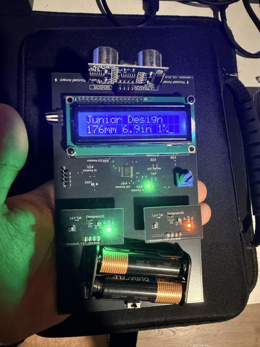
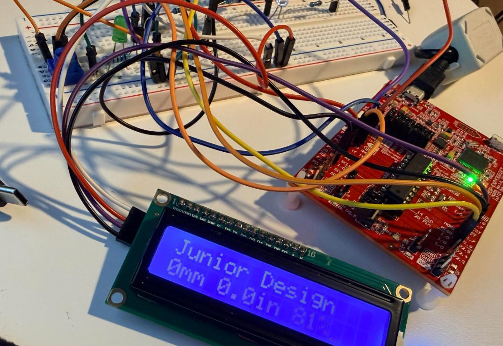
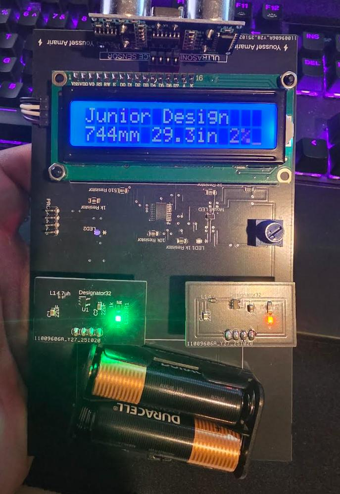

# MSP430 Ultrasonic Range Finder

A battery-powered range finder built around an MSP430G2553. It measures distance with an HC-SR04 ultrasonic sensor and shows it on a 16x2 LCD in millimeters and inches. I designed the boards, assembled them, and wrote the application code on my own.

## What it does

- Measures distance by timing the ultrasonic echo, with 1.7 mm resolution
- Shows the reading in mm and inches on an I2C LCD, refreshed roughly twice a second
- Reads a potentiometer through the ADC and uses it to dim an LED with PWM
- Runs from two AA cells through two boost regulators I built: 3.3 V for the microcontroller, 5 V for the LCD and sensor

## What I built

- **Power:** chose the regulators, checked efficiency and junction temperature by hand, prototyped on a breadboard, then built a small boost-converter PCB in 3.3 V and 5 V versions
- **Main board:** pin planning from the datasheet, schematic, and PCB layout in Fusion 360, fabricated by JLCPCB
- **Assembly:** stencil, solder paste, surface-mount placement, reflow, and hand-soldered through-hole parts
- **Testing:** bench supply, multimeter, electronic load, oscilloscope, and thermal camera
- **Firmware:** the application code, in four bring-up stages

## Repo layout

| Folder | Contents |
|---|---|
| [`firmware/`](firmware/) | The four programs and my pin configuration |
| [`hardware/`](hardware/) | Pin map, schematics, board layouts, and parts lists |
| [`docs/power_design.md`](docs/power_design.md) | Regulator selection, thermal calculations, and bench results |
| `images/` | Photos and drawings |

## From breadboard to board

| Breadboard prototype | Finished board |
|---|---|
|  |  |

## A note on the firmware

The programs call a hardware driver header for the low-level clock, timer, ADC, and I2C routines. That header was supplied to me and is not my work, so it is not included. Details are in [`firmware/README.md`](firmware/README.md).
