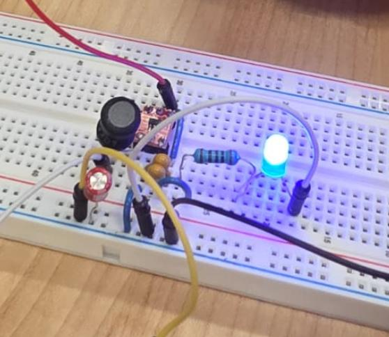
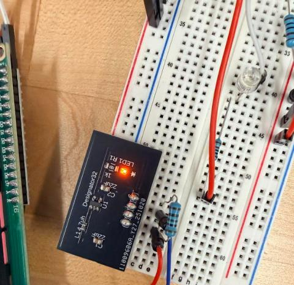
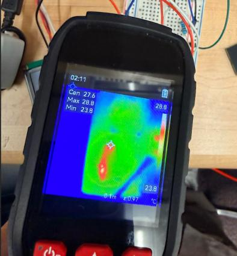

# Power design and test results

The range finder runs from two AA cells. The microcontroller needs 3.3 V and the LCD and ultrasonic sensor need 5 V, so both rails are boosted from the battery.

## Regulator selection

I chose the TI TPS613221A (3.3 V) and TPS613222A (5 V) boost converters using TI WEBENCH and the datasheet.

| | TPS613221A (3.3 V) | TPS613222A (5 V) |
|---|---|---|
| Efficiency at 150 mA (WEBENCH) | 87.7% | 88.8% |
| Peak switch current limit, min / typ / max | 0.75 / 1.20 / 1.60 A | 1.10 / 1.80 / 2.50 A |
| Maximum junction temperature | 125 C | 125 C |
| Parts per regulator | 5 | 5 |

Why these parts: high efficiency for battery life, enough current headroom for this load, a low part count, a small footprint, and built-in current limiting.

## Thermal check

For a 2.4 V input and 150 mA output, using the junction-to-ambient figure of 189.7 C/W and 28 C ambient:

| | 3.3 V | 5 V |
|---|---|---|
| Output power | 0.495 W | 0.750 W |
| Loss in the regulator | 0.069 W | 0.095 W |
| Input power | 0.564 W | 0.845 W |
| Input current | 0.235 A | 0.352 A |
| Junction temperature | 41.2 C | 45.9 C |

Both sit far below the 125 C limit.

## Breadboard prototype

Tested from a 2.9 V bench supply before committing to a PCB.

| | 3.3 V | 5 V |
|---|---|---|
| Output voltage, LED load only | 3.329 V | 5.030 V |
| Output on the electronic load | 3.320 V at 32 mA (100 ohm) | 5.021 V at 23 mA (200 ohm) |
| Output ripple, peak to peak | 168 mV | 146 mV |

A thermal camera showed a maximum of about 30 C on the 5 V circuit.

## Assembled regulator boards

The boards were assembled with a stencil, solder paste, and reflow, then tested from 2.9 V with a 100 ohm load.

| | 3.3 V board | 5 V board |
|---|---|---|
| Output, no load | 3.25 V | 4.99 V |
| Output with 100 ohm load | 2.82 V (28 mA) | 4.995 V (50 mA) |
| Hottest point on the board | about 28 C | about 29 C |

The 5 V board held its output under load. The 3.3 V board sagged to 2.82 V with the 100 ohm load at a 2.9 V input, which is the weak point of this build and the first thing I would revisit.
