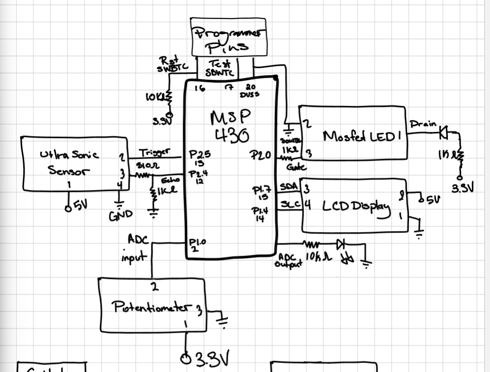
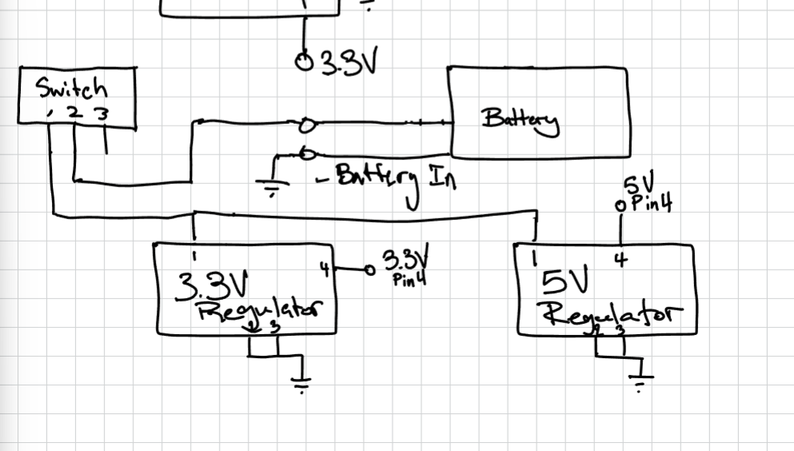
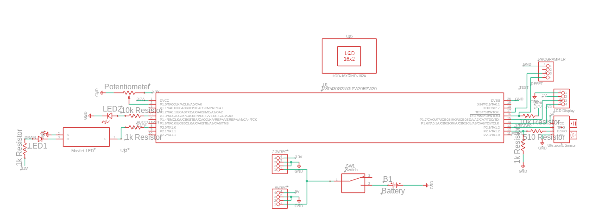
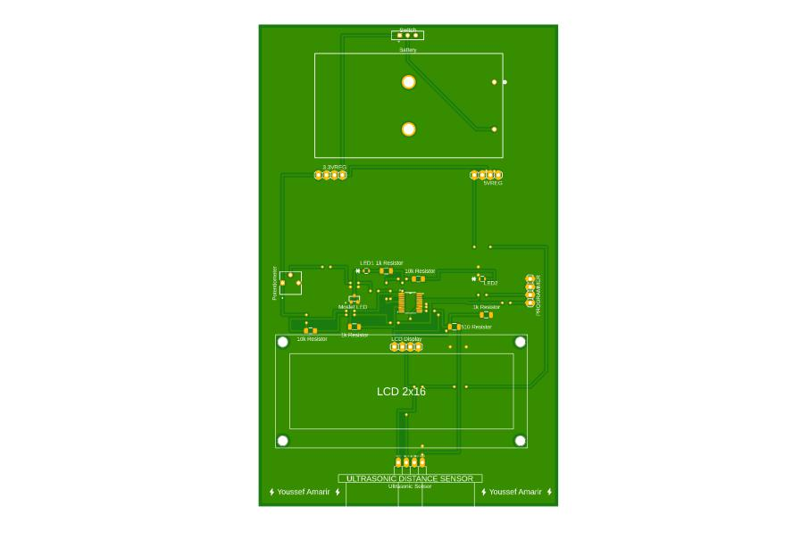
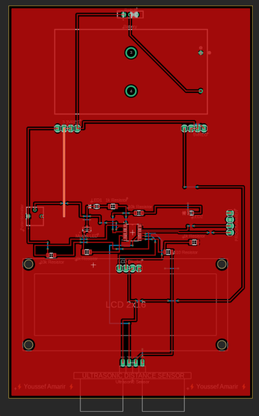
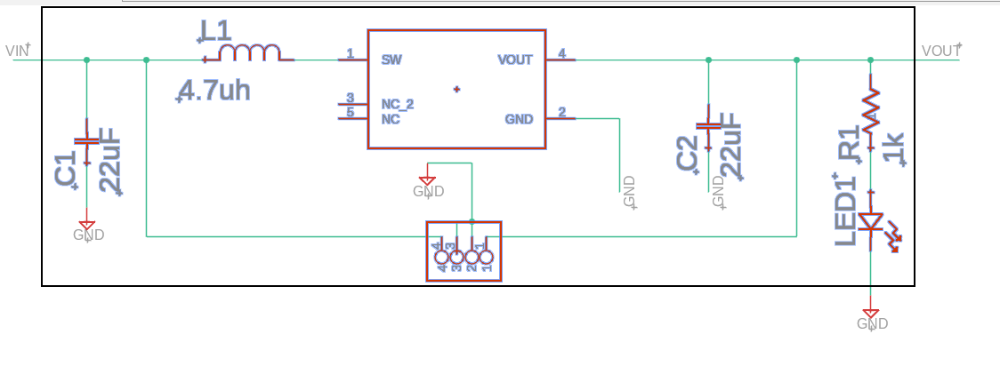
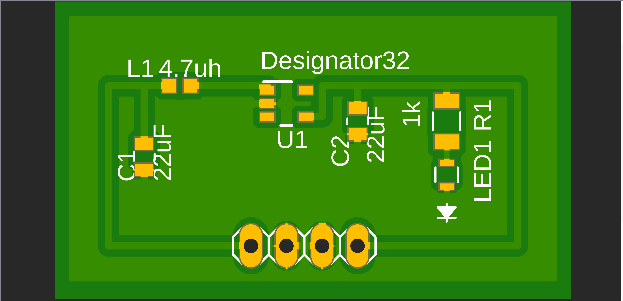
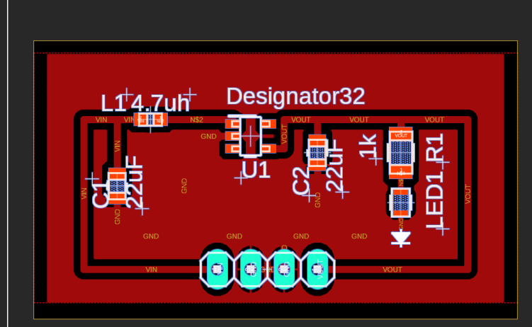

# Hardware

## Block diagram

## MSP430G2553 pin map (20-pin TSSOP)

| Function | Port | Pin | Connects to |
|---|---|---|---|
| Supply | DVCC | 1 | 3.3 V regulator output |
| Ground | DVSS | 20 | Ground |
| I2C clock | P1.6 | 14 | LCD SCL |
| I2C data | P1.7 | 15 | LCD SDA |
| Echo | P2.4 | 12 | HC-SR04 echo, through a 510 ohm / 1k divider |
| Trigger | P2.5 | 13 | HC-SR04 trigger |
| ADC input | P1.0 | 2 | Potentiometer wiper |
| PWM LED | P1.3 | 5 | LED through a 10k resistor |
| MOSFET gate | P2.0 | 8 | BS170 gate through 1k, switching LED1 |
| Programming | TEST / SBWTCK | 17 | Programmer header |
| Programming | RST / SBWTDIO | 16 | Programmer header, 10k pull-up to 3.3 V |

The sensor runs from 5 V, so its echo output is divided down before it reaches the 3.3 V microcontroller.

## Connectors

| Connector | Pin 1 | Pin 2 | Pin 3 | Pin 4 |
|---|---|---|---|---|
| 3.3 V regulator board | VIN (from switch) | GND | GND | VOUT 3.3 V |
| 5 V regulator board | VIN (from switch) | GND | GND | VOUT 5 V |
| LCD | GND | VCC (5 V) | SDA | SCL |
| Ultrasonic sensor | VCC (5 V) | Trigger | Echo | GND |
| Programmer | VCC (3.3 V) | GND | SBWTCK | SBWTDIO |

## Main board

Designed in Fusion 360 and fabricated by JLCPCB.

| Top | Copper |
|---|---|
|  |  |

| Ref | Part | Value / part number |
|---|---|---|
| U1 | Microcontroller | MSP430G2553IPW20 |
| U$1 | MOSFET | BS170 (SOT-23) |
| U$4 | Ultrasonic sensor | HC-SR04 |
| U$5 | LCD | 16x2 with I2C backpack |
| R1 | Potentiometer | 10k, 3362P |
| R2 | Resistor | 510 ohm, 1206 |
| R3, R4 | Resistor | 10k, 1206 |
| R5, R6, R7 | Resistor | 1k, 1206 |
| LED1, LED2 | LED | 0805 |
| SW1 | Power switch | Slide switch |
| B1 | Battery holder | 2 x AA |
| Headers | 1x4, 2.54 mm | 3.3 V regulator, 5 V regulator, LCD, programmer |

## Regulator board

One small boost-converter board, built twice: once with a TPS613221A for 3.3 V and once with a TPS613222A for 5 V. They plug into the main board on 4-pin headers.

| Top | Copper |
|---|---|
|  |  |

| Ref | Part | Value / part number |
|---|---|---|
| U1 | Boost converter | TPS613221ADBVR (3.3 V) or TPS613222ADBVR (5 V) |
| L1 | Inductor | 4.7 uH, LQM18PN4R7MFRL |
| C1, C2 | Capacitor | 22 uF, CL21A226MQQNNNE |
| R1 | Resistor | 1k, 1206 |
| LED1 | Power indicator LED | 0805 |
| Header | 1x4, 2.54 mm | VIN, GND, GND, VOUT |
